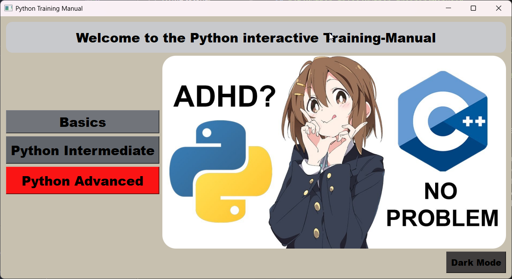
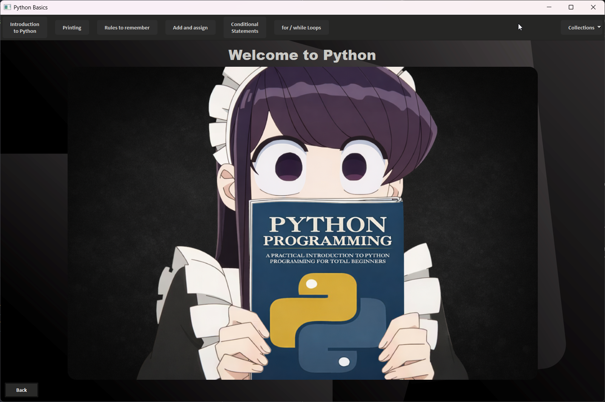
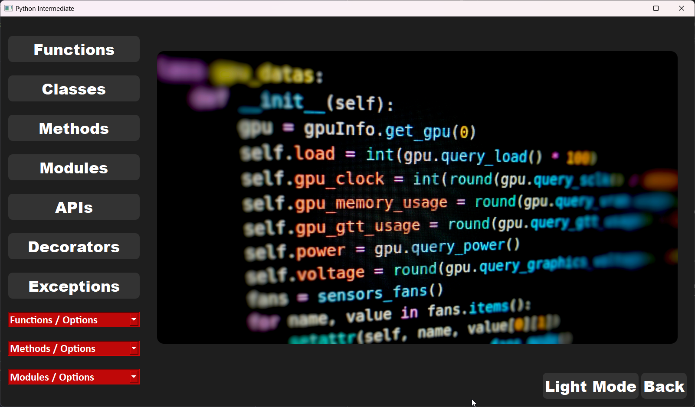

## Python Training Manual
An interactive desktop guide for learning Python, built with `PyQt5`. Topics are split into three levels - Basics, Intermediate and Advanced - and explained through illustrated cheat sheets and short text lessons.

This was one of my first PyQt5 projects, built mostly by hand while learning from tutorials.

> **STATUS: Work in progress**. The Basics and Intermediate sections are mostly done; the Advanced section is still a skeleton.





## Features
Main Menu
- Three entry points: Basics, Intermediate, Advanced
- Light / dark theme toggle

Basics
- Toolbar navigation: Introduction, Printing, Rules to remember, Assignment operators, Conditional statements, for / while loops
- Collections menu: Lists, Tuples, Sets, Dictionaries
- "Built-in Methods" button for each collection type

Advanced
- Topic grid: Advanced Classes, Math, OS, Pandas, Matplotlib, PyQt, Django, Projects
- Each topic opens its own window - currently placeholders

## Requirements
- Python 3.8+
- Windows, macOS or Linux

## Installation
1. Clone the repository:
```bash
git clone https://github.com/JonathanMovement/Python_trainingManual.git
cd Python_trainingManual
```
2. Create and activate a virtual environment:
```bash
python -m venv venv
venv\Scripts\activate
```
3. Install the dependencies:
```bash
pip install -r requirements.txt
```

## Usage
Start the app with:
```bash
python Training_Manual.py
```
## Building the .exe (Windows)
```bash
pip install pyinstaller
pyinstaller --noconfirm --windowed --name "Python Training Manual" --add-data "Pictures, icons;Pictures, icons" --add-data "Text_files;Text_files" Training_Manual.py
```

## Lincense
This project is licensed under the GNU General Public License v3.0 - see [LICENSE](LICENSE) for details, since it uses PyQt5, which is GPL-licensed.